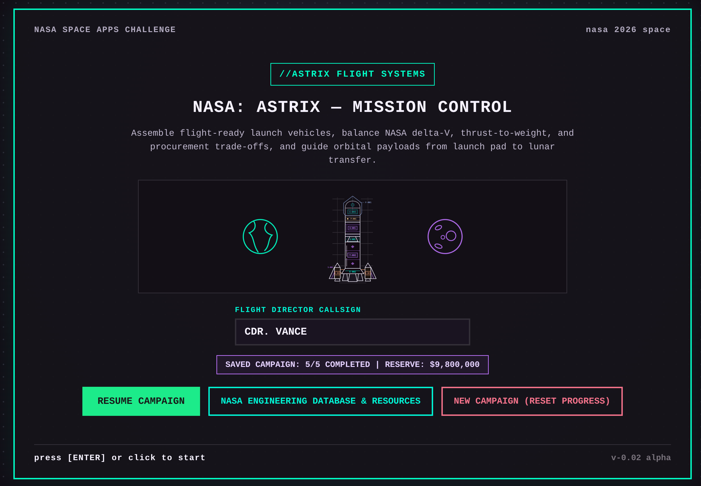

# NASA: Capricorn — Mission Control

NASA: Capricorn is a browser-based rocket assembly and mission-planning game
built with React and Vite. Players take the role of a flight director: choose a
mission, assemble a launch vehicle, balance its performance against mission
constraints, and launch when the build is ready.

## Main Menu



The start menu accepts a flight-director callsign, resumes a saved campaign,
starts a new campaign, and opens the NASA engineering database.

## What the Project Does

The game presents five missions, from low-Earth-orbit resupply to lunar relay
and heavy-cargo delivery. Players install components and choose factory-new or
surplus hardware, then use live telemetry to compare:

- Cost against the mission budget.
- Preparation time against the launch deadline.
- Thrust-to-weight ratio and delta-V against mission targets.
- Vehicle mass and the game's reliability estimate.

The mission-control dashboard includes a rocket assembly bay, flight scene,
telemetry log, mission briefings, and an in-app NASA Codex with reference
tables and external resources. Campaign outcomes and the callsign are saved in
browser local storage.

## Challenge

The project is presented as a NASA Space Apps Challenge experience and draws
on the [Space Mission Design Game challenge resources](https://www.spaceappschallenge.org/2026/challenges/space-mission-design-game/?tab=resources).
It makes mission-design trade-offs tangible through an interactive build,
budget and schedule constraints, launch checks, and visible mission outcomes.

This is an educational game, not a real launch-planning tool. Its vehicle
performance and flight are simplified, predefined game rules; it does not
calculate real trajectories or use live NASA data. See
[Challenge context](docs/challenge.md) for the project's approach and limits.

## Run Locally

Requires Node.js and npm.

```bash
npm install
npm run dev
```

Create and preview a production build with:

```bash
npm run build
npm run preview
```

## Technical Overview

The app is a client-side React 19 single-page application built with Vite 6.
`src/App.jsx` coordinates screens, mission and campaign state, assembly, and
launch behavior. UI components live in `src/components/`, static missions and
parts in `src/data/`, derived metrics in `src/utils/`, flight animation in
`src/hooks/`, and styling in `src/styles/`. Rocket-part illustrations are in
`assets/rocket-parts/`.

For details, see [Gameplay](docs/gameplay.md) and
[Technical documentation](docs/technical.md).
