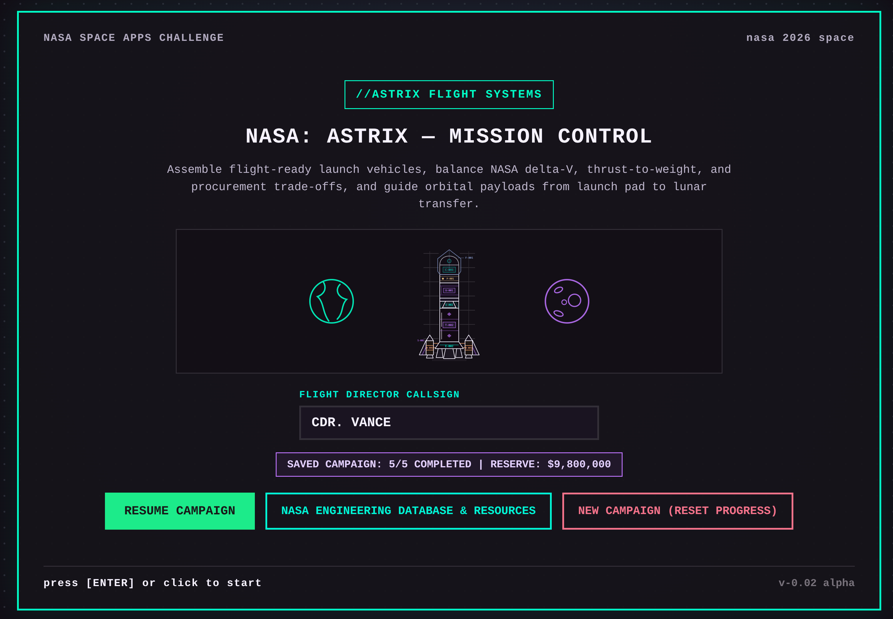

# Project overview

## What Capricorn is

NASA: Capricorn — Mission Control is a single-page, browser-based rocket assembly and mission-planning game. Players act as a flight director: choose a mission, assemble a vehicle from available components, evaluate its readiness, and launch it if it satisfies the contract.

The interface presents this loop as a mission-control dashboard. A briefing explains the objective and constraints, an assembly bay shows the rocket and available parts, and a telemetry panel summarizes whether the current build is viable. A separate start menu introduces the game, accepts a callsign, and opens the NASA engineering codex.

## Intended experience

The game makes engineering trade-offs visible without requiring specialist software. A part can improve vehicle capability while adding cost, mass, or preparation time. Surplus hardware reduces cost and preparation time but lowers the displayed reliability estimate. Players can experiment manually or use Auto-Fit to load a ready-made configuration, then review the telemetry before launch.

Successful flights advance the campaign. The game records completed missions, cargo delivered, astronauts rescued, and funding reserve. Progress and the callsign survive a page reload in browser local storage.

## Main menu

The start menu provides the campaign entry point, callsign field, and link to the engineering codex. When a saved campaign has progress, it also shows the campaign summary and options to resume or start over.

## Scope and realism

Capricorn is a game and an educational visualization, not an engineering-grade simulator. The missions, parts, and reference tables are bundled in the project; the app does not fetch live NASA telemetry or calculate real launch trajectories. Read [Challenge context](challenge.md) for the intended learning problem and [Technical documentation](technical.md) for the model's boundaries.
